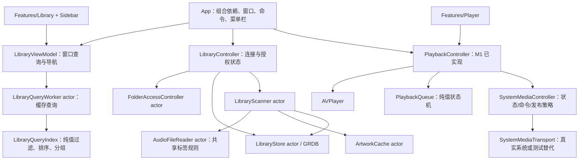

# 架构约定

本文区分已实现部分和待人工验收部分。M1–M7 已实现本地播放/索引/浏览/队列、系统集成和体验收尾代码，人工验收尚未完结；验证记录见 HANDOFF 与 VALIDATION。

## 1. 产品边界与布局

第一阶段支持本地 m4a / mp3 / flac / wav / aiff（含 aif 扩展名）。读取阶段通过 AVFoundation 的 isPlayable、音轨和时长预检，失败则跳过并记录；预检不保证完整解码成功，不能仅凭扩展名宣称支持 FLAC。实际播放时解码失败会显示错误并停在该条目，不自动跳过；交叉渐变准备失败不提前打断当前曲目，等自然换曲后再报告失败。

窗口结构：

- 左侧 Sidebar：搜索、最近添加/艺术家/专辑/歌曲，播放列表区固定“所有音乐”，智能列表区最近播放/最常播放；分组可折叠，选中与 hover 使用系统样式。打开音频保留工具栏添加菜单和 Command-O 入口。
- 中间 Library：歌曲表格、专辑网格、艺术家列表及维度详情。
- 右侧 Queue：可开关的原生布局面板，窄窗口从播放条按钮弹出。
- 底部 Player：内容区底部悬浮玻璃播放条；封面/曲名点击打开 Now Playing sheet，独立歌词按钮打开本地歌词，歌词页封面保留图片 popover。

主体使用 `NavigationSplitView`，右侧队列不必永久占用一列。窄窗口可折叠侧边栏/队列，播放控件通过自适应布局保证不截断。允许设置合理的最小可用窗口尺寸。工具栏使用 `.toolbar`，列表使用 `Table`/`List`。系统色彩和材质跟随深浅色与辅助功能设置。

播放条使用 NavigationSplitView detail 的底部 safeAreaInset，透明外边距形成悬浮效果，并为列表末行保留空间；侧边栏延伸到窗口底部。窗口默认 1100×700、最小 640×520，按内容最小尺寸自由缩放，不设阻挡大屏/全屏的硬性最大值。根 HStack 的 onGeometryChange 测量完整窗口，资料库区域用原生 HStack/Divider 并列 NavigationSplitView 与队列；不足 900 点时队列改从按钮弹出，跨阈值自动收起。续验在系统 inspector 的宽窄切换中复现 AppKit 约束更新异常，因此不再使用 inspector。内容区不足 560 点时歌曲切为紧凑 List，选择、主操作、右键菜单与 Table 共用 VM 快照，普通列表保留排序菜单，智能列表保持固定排名。

播放条以 2026-10-23 最新截图为准，保持单行胶囊：左侧播放控制，中间 32 点封面/单行曲名和下沿进度，右侧省略号模式菜单/歌词/队列/音量。窄窗口曲名截尾；时间移入进度辅助功能值与悬停提示。背景直接使用系统 glassEffect(.regular, in: .capsule)，不叠加额外底色；减少透明度或增加对比度时仍完全不透明并显示边框。音量 popover 支持 Escape/“完成”。模式图标菜单保留中文辅助功能名称。Command-F 通过场景 focused value 展开边栏，再由可取消 task 等视图进入后聚焦，不安装全局键盘事件监听。

UI1 的 NowPlayingView 为独立 Feature 视图：可用范围 460×520 至 760×900，默认 600×660，封面随高度调整；复用当前封面缓存、PlaybackController 和 PlaybackProgressView。模糊封面叠语义渐变背景，不新增提色任务或动画计时器；辅助功能高对比/减少透明度关闭装饰背景。玻璃控制使用系统 buttonStyle，歌词仍为本地读取。封面/歌曲变化由现有路径与条目标识隔离；关闭/Esc 只关闭面板，不中断播放。队列展开与歌词滚动动画使用 .snappy 并尊重减少动态效果。

SlimPlaybackSlider 现为纯 SwiftUI View，使用系统 Slider 与 mini 控件尺寸，由系统绘制轨道和玻璃旋钮；不再使用自绘 NSSliderCell 或隐藏旋钮。拖动起止继续调用 PlaybackScrubState，左右键通过同一绑定跳转 5 秒，点击提供显式焦点。进度区保留 18 点高度以容纳原生控件；切换条目继续以 entryID 重建并拒绝旧回调。不增加计时器。

播放刷新：关闭交叉渐变时 AVPlayer 观察间隔为 250ms；启用时保持 50ms 曲尾检测精度，开关时成对移除/重建观察者。两种模式下 UI 进度和定期媒体检查均限制为约 4Hz，曲尾检测直接读取音频时钟，相同进度不重复写入 Observation，seek 仍即时发布。重叠期间的 20ms 增益任务不变。声波使用 200ms periodic 时间线和固定尺寸 Canvas，不通过改变子视图高度驱动行布局；暂停/减少动态效果时不创建时间线。CPU 隔离采样条件和结果见 VALIDATION，不等同于 Apple Music 同条件对比。

2026-10-23 性能补充：ArtworkView 按显示尺寸与 displayScale 请求 ArtworkThumbnailCache actor，ImageIO 后台生成最长边不超过 512 的缩略图；同内容/尺寸共享 CGImage，解码缓存成本目标 16 MiB，原压缩数据热缓存成本目标 8 MiB。NSCache 自动淘汰并非硬上限，视图仍持有当前图片。取消与代次在异步解码返回后再次核对。查询结果分组仅保存代表曲目与计数，不建立两套完整分组歌曲数组。UI1 将全宽 24 点 NSView 拖动带移入根视图顶部 safeAreaInset，替代 VStack/GeometryReader 嵌套，修复宽窗表头遮挡。仍通过 performDrag 使用系统窗口移动，不更改媒体时钟或系统三指设置。

## 2. 分层与依赖方向



`Core/Models` 不依赖 SwiftUI 或 AppKit；数据库适配放在 `Core/Library` 的扩展中。View 不直接操作 SQL、枚举文件或注册远程命令。

AppModel 与 LibraryScanner 共用 AudioFileReader 的校验/标签实现；真实单文件入口显式注入 ArtworkAudioFileReader，读取 metadata 后交给原 ArtworkCache。普通 AudioFileReader.read 仍不提取图片，留给默认测试/预览路径。AudioFileReading.readResult 默认兼容旧 read，适配器通过 AudioFileReadResult 返回本次图片/标签警告，AppModel 在代次检查后展示，避免共享“上次警告”串任务。LibraryController 维护连接、授权、扫描状态和已加载 tracks；AppModel 合并库内与临时歌曲，按路径去重，持久化同路径始终优先。ContentView 交 tracks 快照给窗口内 LibraryViewModel；查询层不另建扫描/数据库/授权。

应用级状态由 LiquidmusicApp 持有 AppModel，唯一主窗口 Window(id: main) 和 MenuBarExtra 注入同一个 PlaybackController。M6 将原 WindowGroup 收敛为唯一主窗口，打开/恢复沿用相同窗口和浏览状态。系统媒体在真实 App 生命周期中幂等注册，Preview 显式注入未连接系统媒体的实例。

建议目录（“计划”表示还未创建对应 Swift 文件）：

```text
Liquidmusic/
  App/
    LiquidmusicApp.swift         场景和生命周期入口
    ContentView.swift            主窗口组合；不承载索引业务
    AppModel.swift               已实现：共享依赖、单文件导入和错误聚合
    WindowLifecycle.swift       已实现：运行隔离、委托桥、窗口恢复与菜单栏组合
  Features/
    Sidebar/SidebarView.swift
    Library/
      LibraryController.swift   已实现：连接、保存/恢复授权、操作状态
      LibraryFoldersView.swift  已实现：文件夹管理、错误与重新授权
      LibraryViewModel.swift    已实现：窗口浏览状态与后台缓存查询
      LibraryView.swift         已实现：状态、内容与维度详情切换
      SongsTable.swift          已实现：原生表格、排序与播放操作
      AlbumsView.swift          已实现：专辑网格
      AlbumHeaderView.swift     AW2：专辑详情封面与标签
      SPXArtwork.swift          AW2：只在内存绘图的封面预览数据与 loader
      ArtistsView.swift         已实现：艺术家列表
      ImportProgressView.swift  已实现：扫描进度与导入问题报告
      AudioImportNotice.swift   AW3：单文件非阻断提示与关闭入口
      ScanReviewView.swift      已实现：覆盖/清理前审阅确认
    Player/
      ArtworkView.swift         封面与声波指示
      ArtworkLoadingState.swift  AW2：可取消候选加载、回退与迟到结果隔离
      PlayerBar.swift           播放条、传输控制、歌词/Now Playing 入口
      NowPlayingView.swift      UI1：大封面、渐变背景、玻璃控制与时间进度
      PlaybackProgressView.swift  已实现：进度编辑与旧滑块回调隔离
      QueueView.swift           队列与 MiniPlayerView
  Core/
    Models/Track.swift          Track、枚举、SPXData
    Models/LibraryQuery.swift   查询索引、比较器、维度标识和结果值类型
    Models/AlbumArtwork.swift   AW1 已实现：候选、选择协议与可取消的纯值排序去重
    Models/PlaybackScrubState.swift  可测试的拖动/键盘进度编辑状态
    Models/LibraryFolder.swift  LibraryFolder、ImportIssue、授权状态值类型
    Models/LibraryScan.swift    文件指纹、元数据结果、进度、报告和扫描方案
    Models/AudioFileReadResult.swift  AW3：单文件曲目与警告的 Sendable 结果
    Playback/
      AudioFileReader.swift     已实现：单文件异步校验/基础标签与临时授权
      ArtworkAudioFileReader.swift  AW3：单次元数据/图片缓存适配，无数据库副作用
      PlaybackQueue.swift       已实现：UUID 队列、随机轮次、优先项和访问历史
      PlaybackController.swift  AVPlayer 与可观察状态
      SystemMediaController.swift
      SystemMediaTransport.swift  系统媒体边界、命令与快照值类型
    Library/
      LibraryStore.swift        GRDB：v1/v2 索引、v3 设置、v4 独立聆听记录迁移
      LibraryPaths.swift        AW3：I/O actor 共用的 Application Support 目录定位
      FolderAccessController.swift  已实现：准备/提交/丢弃授权与租约生命周期
      LibraryScanner.swift      已实现：准备方案、去重、校验与提交
      ArtworkCache.swift        已实现：ImageIO 缩略图与有界数据缓存
Tests/                          独立 XCTest target，逻辑/集成测试与合成素材/旧数据库快照
LiquidmusicUITests/              独立 macOS XCUITest target，含原生设置的实际 App 合成事件回归
Scripts/verify-ui.sh             构建 App + 本地 ad-hoc UI runner，按构建路径启动隔离 App
```

## 3. 并发与生命周期

- `@MainActor @Observable` 管理 UI 可观察状态、AVPlayer 控制和 AppKit 选择器。
- 扫描、数据库、图像缩略图处理用 actor 隔离，不能在主线程递归枚举或逐个解码封面。
- 先用有限并发（初版串行后台读取也可），禁止为整个音乐库一次性创建无限任务。
- `Track`、扫描进度、导入问题等为 Sendable 值类型；不要跨 actor 传递可变 NSImage 或 AVPlayerItem。
- 扫描任务可取消；换文件夹或新扫描不得让旧任务的结果覆盖新任务。使用任务 ID / generation 校验。
- PlaybackController 按应用生命周期保持唯一；交叉渐变期间由它持有两路 AVPlayer。观察者/通知/媒体命令必须有明确清理路径。若后续增加协议，应有实际测试或替换需求，避免空壳抽象。

## 4. 文件访问与持久化

### 用户文件夹授权

`NSOpenPanel` 选择目录 → 创建待提交的 security scope 租约 → 校验可打开根目录 → 创建只读 `.withSecurityScope` 书签 → 持久化 → 提交长期租约 → 自动开始新文件夹扫描。启动恢复只加载已有索引，不自动重新扫描。

LibraryController 只在真实 App start 时打开存储。Preview 不调用 start，Tests 使用显式注入的内存/临时库；共享 scheme 的 TestAction 设置 LIQUIDMUSIC_TESTING=1 且 shouldUseLaunchSchemeArgsEnv=NO。M6 发现并修复了此前继承 Launch 环境导致变量不生效的问题，AppRuntime 另识别标准 XCTest 与 Preview 环境；真实 App 组合在隔离模式下不创建真实库、不启动媒体、不插入菜单栏或连接主窗口桥。

重新启动时恢复书签，处理过期书签；无法恢复时提示重新授权。只保存字符串路径不够。用户授权的根目录访问需要覆盖扫描和之后的播放生命周期，不能扫描结束立即停止访问。每次成功 start 都要有对应 stop，避免重复启动泄漏。核对 App Sandbox 和 app-scoped bookmark entitlement。

文件夹取消选择不是错误。首次启动可以显示引导页，不要求自动弹出侵入式选择器。后续支持添加多个文件夹，避免覆盖现有资料库。

### SQLite

存储目录使用系统 Application Support 下的 Liquidmusic 子目录（沙盒下自然解析到容器），不要写进仓库。通过 GRDB 迁移创建以下概念表，最终列名可随实现统一：

| 表 | 核心字段 | 约束/用途 |
|---|---|---|
| libraryFolder | id, bookmarkData, displayName, lastScanAt | 持久化授权来源 |
| track | id, folderID, path, title, artist, album, albumArtist, duration, discNumber, trackNumber, artworkPath, modifiedAt, fileSize | id 主键，规范化文件路径唯一，folderID 可索引 |
| importIssue | id, folderID, filePath, reason, occurredAt | 记录不支持、损坏、权限和元数据失败 |
| appSettings | id, value | v3 新增；固定 id=1，JSON BLOB 保存 AppPreferences，不改歌曲索引 |
| listeningActivity | path, addedAt, lastPlayedAt, playCount | UI1/v4 新增；按路径保存独立聆听记录，不修改 track 或音频 |

LibraryStore 首次插入曲目时生成 UUID；后续按标准化且解析符号链接的路径去重并保留 UUID。单文件临时播放仍以路径为 ID，只有入库后才获得稳定 ID。文件移动先视作旧文件丢失和新文件加入，不实现跨路径移动识别。重复目录选择保留原文件夹 ID；重新授权不能占用另一条已有文件夹记录的位置。

数据库初始化失败向用户暴露，不切换空内存库；迁移不启用自动清库。GRDB 经 SPM 固定为 7.11.1，Package.resolved 随工程维护。默认保存 `Liquidmusic/Library.sqlite` 和同级 `Artwork/`；内存库不创建磁盘目录。

`upsertTracks` 是基础存储接口，测试用于准备索引。真实扫描使用 `applyScan`，同时校验数据库基线、确认状态、外键和有效时长；以事务应用新增/更新/删除、问题记录和完成时间。重叠目录由路径最具体的已注册根目录拥有，与扫描先后顺序无关。M3 的 v2 迁移仅新增可空 fileSize 列；旧索引保留，首次重扫读取一次以补齐指纹。

恢复时刷新过期书签；无法恢复的记录保留并标记“需要重新授权”。书签准备、写库、提交授权分开执行，数据库失败会丢弃新租约，已有播放所依赖的租约保持有效。根目录租约覆盖应用生命周期，扫描完成不能调用 release/shutdown。用户索引清理仅通过确认后的扫描方案执行，不提供任意批量删除或音频文件删除入口。

### 索引流程

1. 恢复访问权限，检查路径存在。
2. 后台递归枚举允许扩展名；跳过隐藏文件、包、目录符号链接，防止循环。
3. 发布“正在查找文件”状态；枚举完成后发布总数，再显示确定进度。
4. 比较文件修改时间与大小，对未变化文件复用索引；封面缓存丢失时重新提取。AVURLAsset 异步读取时长、可播放性和 metadata。
5. 标签缺失时标题回退文件名，艺术家/专辑用本地化占位，albumArtist 回退 artist。无效时长不进入正常可播放记录。
6. 单文件失败加入方案的问题列表并继续；序列读取，约每 100ms 更新进度。读取期间不修改现有索引，取消可直接丢弃方案。
7. 完整枚举且未取消时才计算失踪索引。纯新增方案自动保存；包含更新/移除的方案先展示路径与字段变化，用户确认后才提交。枚举不完整时绝不清理旧索引。
8. 提交前再校验目录访问、文件指纹、失踪文件是否重现和数据库基线；不匹配则要求重新扫描，避免陈旧方案覆盖后续修改。
9. 以单个事务写入当前根目录的整批变更，完成后刷新 tracks 和报告。每个根目录独立提交；取消后续目录不撤销之前已经完成的导入。

### 封面

2026-10-20 AW1–AW3 代码已实现：`Core/Models/AlbumArtwork.swift` 定义 Sendable 候选、纯选择协议与 AlbumArtworkSelector。后台 LibraryQueryIndex 初始化时按完整 AlbumIdentity 一次分组，预计算候选；只使用正碟号/曲号再按稳定 ID 排序，未知编号置后，排除空白路径并按原始路径去重，过程可取消且无 I/O。LibraryAlbum.artworkCandidates 与非空专辑 scope 的 LibraryQueryResult.albumArtworkCandidates 消费同一快照，搜索/排序不改变封面候选；普通或空结果 scope 的详情候选为空。representative/count 和播放快照语义保持原样。

AW3 的 ArtworkAudioFileReader 在独立 actor 中调用一次 readMetadata，确有图片才延迟解析 Application Support/Liquidmusic/Artwork 并创建缓存对象。LibraryPaths 与数据库共用相同目录定位，不触发 SQLite 打开/迁移；无封面不碰缓存目录。图片失败返回非阻断警告，取消继续抛出；AppModel 的 AudioFileAccess 租约覆盖读取及缓存，generation/取消拒绝旧结果。真实 App 显式注入，AppRuntime 隔离分支与默认 AppModel 仍用普通 reader。现有库内同路径记录优先，新发现图片而旧索引缺图时提示重扫审阅，不回写已有 Track。提示条跟随本次导入，可关闭，新选择/取消清空旧提示。单文件只更新临时曲目；可能留下不可变的未引用缓存，仍不自动清理。

AlbumsView 和 AlbumHeaderView 将完整候选路径交给 ArtworkView。它保留单曲 `track:size:` 入口，并通过 `.task(id: paths)` 调用 MainActor ArtworkLoadingState，generation/取消/离开视图防止串图，缺失或无法解码按序尝试下一候选，全失败占位。新路径组尚未调度时也隐藏旧图片。I/O 继续在 ArtworkCache actor，NSImage 仅 UI 侧构造；不增加第二个缓存。Data loader 可由参数或环境注入，LibraryView 将注入延续到歌曲行，SPXArtwork 预览只产生内存图片，不访问模拟文件。单曲与系统媒体仍显示自身 artworkPath，不回写同专辑其他曲目的图片。范围与验收见 `ALBUM_ARTWORK.md`；以下为现有缓存实现。

metadata 图片通过 ImageIO 下采样为最长边 512 的 JPEG，写入 Application Support/Artwork。缓存按 SHA-256 + 尺寸版本命名，只新增，不覆盖旧文件；相同图片复用已有文件。原图数据超过 20MB 或超大像素面积会跳过并报告，音频仍可入库。ArtworkView 通过独立 actor 按需读取小图，NSCache 最多 160 项/32MB，NSImage 只在 UI 侧创建。取消扫描可能留下未引用的缓存文件，暂不自动删除。

ScanReviewView 的 List 行使用显式 ZStack 容器稳定行结构，规避本机 Xcode Preview 的自定义不透明列表行崩溃；浅/深色预览均已验证。不要仅为去掉容器而回退该结构，除非重新验证预览和真实窗口。

## 5. 浏览行为（M4 已实现）

UI1 扩展：LibraryViewModel 保存最多 100 条浏览位置（section/scope/displayMode），支持返回/前进与新分支清除前进栈；查询和普通排序保留当前设置。专辑/最近添加默认网格，其余歌曲入口默认列表；艺术家与固定播放列表不展示不适用的视图切换。

ListeningActivityController 由 AppModel 持有，串行调用 LibraryStore 的 v4 表；资料库快照首次出现时以当前时间登记 addedAt，不冒充历史导入时间。PlaybackController 成功进入 playing 时按 loadGeneration 发布一次回调；暂停/恢复、seek、缓冲恢复不重复计数，手动重开、自然循环与播完重播计新一次，失败的准备项不计数。交叉渐变只记录已提升为当前播放器并实际开始的新曲。预览/隔离模式使用内存控制器，不打开真实 SQLite。

最近播放按 lastPlayedAt 降序，最常播放按 playCount 降序、最近播放时间次序；仅包含当前资料库快照内已播放的曲目。最近添加按 addedAt 降序；相等值按既有稳定标题/ID 次序。搜索和维度过滤继续组合，专辑网格按匹配歌曲首项排名，完整专辑封面候选不变。排名列表使用无可点击排序头的 Table，避免标题排序箭头误导。记录写入失败显示明确提示，不切换空数据库；路径记录不自动清理，也不恢复已消失的临时歌曲。

搜索实时匹配标题、艺术家和专辑，大小写/变音符号不敏感；中文直接做子串匹配，暂不做拼音检索。LibraryQueryWorker actor 缓存规范化后的字段，120ms debounce 合并连续输入；筛选、排序、分组均在后台执行。任务取消与 generation 校验共同拒绝迟到结果。View body 不执行全库过滤。

歌曲 `Table` 与排序菜单共享 TrackSort 比较器，提供标题、艺术家、专辑、时长的升/降序，时长按秒排序。相等值按标题和稳定 ID 排序，支持 Table 多比较器顺序。专辑使用结构化 AlbumIdentity(album, albumArtist) 分组，既区分同名专辑，也避免标签中分隔符碰撞；艺术家按 track.artist 分组。分组数量基于搜索匹配歌曲，点入维度保留搜索与排序，返回恢复分类；切换侧边栏入口清除维度。

双击歌曲以**当前可见、已排序列表**创建播放队列。悬停显示行内播放按钮；当前曲目显示可暂停的声波；右键提供“播放”和“下一首播放”。播放列表入口仅显示固定“所有音乐”，不显示不能用的新增/编辑控件。

LibraryViewModel.play 接收选中 ID，在已展示的 result.tracks 中查找并传递同一快照给播放器；过时 ID 无操作。多选“下一首播放”保留可见顺序，空队列从所选歌曲的首项开始。该入口复用 M5 的纯队列状态机。

每个窗口独立保存 section/query/scope/sort，共享应用播放器和源数据。Sidebar 的歌曲与所有音乐使用不同 tag。LibraryView 区分首次导入、读取/导入中、读取失败、空文件夹、搜索无结果和分类已失效；后台刷新期间保留现有结果并显示进度。Preview 同步注入 SPXData 查询快照，不打开真实库；初始化配置完成前不触发 Observation didSet 查询，防止空查询覆盖预览结果。

## 6. 播放语义（M5 已实现）

| 操作/模式 | 约定 |
|---|---|
| 顺序自然结束 | 播完末尾停止，保留当前曲目，不自动回第一首 |
| 列表循环 | 末尾回第一首 |
| 单曲循环 | 自然结束重播；手动下一首仍前进，末尾停止 |
| 随机 | 当前一轮候选耗尽前不重复；下一轮重新洗牌，避免立即重复（只有一首除外） |
| 上一首 | 进度超过 3 秒回到曲首；否则回播放历史/上一首 |
| 下一首播放 | 插到当前条目后，多个插入按最新的优先；随机模式下也优先处理 |
| 单曲循环 + 插队 | 自然结束仍重复当前曲；手动下一首才消费插队 |
| 空队列插队 | 直接开始播放该曲 |
| 手动选曲 | 替换队列并从选中歌曲开始，清空旧随机历史 |
| 同一歌曲多次出现 | 用 QueueEntry UUID 区分，不能用 Track.id 作为条目唯一键 |
| 解码/文件访问失败 | 暂停并显示可操作错误，允许跳过或重新授权；不要无限自动跳过重试 |

PlaybackQueue 的候选、优先项和历史全部使用 QueueEntry UUID，下标映射仅用于访问原列表。相同 Track 可有多个独立条目，随机不重复的单位也是条目；显式重复加入歌曲仍会各播放一次。replace 重建条目与历史但保留模式；找不到指定起点时从第一项开始，空列表保持空。

随机源为可注入 seed 的值类型。初始轮把当前项视作已播；后续每轮包含全部条目，只调整首项以避免紧接上一轮末曲。插队不重建本轮候选，消费或跳转优先项时同时移除其候选/优先身份。线性尾部跳过本轮已经消费的插入项，避免从另一个优先项跳回它时重复播放；列表循环的新轮恢复完整列表。

上一首优先使用真实访问历史，随机且无历史时不按物理下标伪造上一首。回退后的下一首沿前进分支重走，再恢复待播安排；新插队、手动跳转或切换模式清除该分支。模式切换保留已播历史与待插队项，重新进入随机时开启以当前曲为起点的新轮；重复设置相同模式不重洗。已播历史保留最近 200 次访问。

QueueView 从纯队列快照显示当前、接下来和历史；upcomingEntries 在副本中模拟本轮手动下一首，不推进真实随机源或无限展开循环。单曲循环显示手动切换顺序并提示自动重复。访问行使用位置区分同一条目的多次出现，跳转仍使用条目 UUID。List 的自定义行保留显式 ZStack，已验证可避开本机 Preview 的原生列表崩溃。

PlaybackScrubState 只保存拖动期间的临时位置，释放后返回 seek 目标；无编辑手势的写入立即触发辅助功能/原生 Slider seek。PlaybackProgressView 绑定当前条目 ID，切歌重建 Slider 并拒绝旧闭包回调。M7 非空桌面续验发现点击后方向键未推进显示时间，补充可聚焦 Slider、点击同时赋予焦点和左右键 −5/+5 秒处理；仍调用同一个 PlaybackController.seek，鼠标不量化到整数秒。M1 的 seekID/loadGeneration 继续保护 AVPlayer completion 和旧 item 通知；结束处理额外忽略 failed/ended 状态。循环、跳转与回退有真实 AVPlayer 静音集成测试，桌面合成事件已验证鼠标点击定位后键盘跳转；物理手势、完整 Tab/VoiceOver 和听音仍需人工验证。

S1 设置扩展已持久化启动音量、默认播放模式及交叉渐变偏好；播放条的临时音量/模式与整个队列不自动持久化，启动不自动播放。

### S1 交叉渐入渐出

2026-10-20 用户明确新增设置与交叉渐变。继续使用 AVPlayer，不接 AVAudioEngine、均衡器或声音增强器。默认关闭，默认时长 6 秒，设置范围为 1–12 秒。只处理自然换曲；单曲循环、没有后继或手动切换保持原语义。短曲的重叠上限为两曲各自时长的一半。

PlaybackController 接近曲尾时推进 PlaybackQueue 副本、静音准备下一首，保留其 AudioFileAccess；准备阶段不消费真实队列。候选 readyToPlay 且进入重叠区间时，提交副本并将其 AVPlayer 提升为当前播放器，进度/封面/系统媒体转到新条目；旧播放器与授权保留至渐出结束。互补线性增益乘全局音量，以新曲的音频时间驱动渐变。暂停两路并停用渐变定时任务，恢复后按原位置继续。切歌/定位/关闭设置/失败/终止释放旧播放器；插队或模式变更丢弃未提交的准备项。时长调整用于下一次渐变，已开始的一次沿原时长完成。

准备失败不提前打断当前曲，曲终按原错误路径提示下一首不可访问或无法解码，不无限跳过。切换时重新绑定观察者并校验播放器身份与 loadGeneration，旧结束通知不得重复推进队列。测试工厂可注入静音 AVPlayer，验证实际音量、暂停、释放和队列提交；实际听音与不同编码器的无缝感受仍需人工验收。

### S1 原生设置

SwiftUI Settings 场景提供系统应用菜单“设置…”与 Command-逗号，不在主窗口新增设置按钮。SettingsView 使用顶部“通用/播放/文件/高级”图标分页、系统字体与语义颜色；通用调整外观/菜单栏播放器，播放调整交叉渐变和默认模式，文件复用原 LibraryFoldersView，使用原审阅流程，高级调整下次启动音量。

SettingsController 由 AppModel 持有，与 LibraryController 共用 LibraryStore actor。AppPreferences 是不依赖 SwiftUI 的 Codable/Sendable 值类型；SQLite 写入成功后才发布偏好，“取消”/关窗丢弃草稿，读写失败可见。读取失败禁止保存，避免以默认值静默替换已有设置。文件夹管理是立即执行的独立流程，不被设置“取消”撤销，界面有说明。隔离宿主/Preview 的 store 为 nil，只在内存编辑；真实 App 启动异步恢复，Preview 不打开真实库或注册媒体。

2026-10-22 交互完善：SettingsController 只在内存记住最后分页，设置窗口提供 ⌘1–⌘4；通用/播放/高级的默认值恢复仅修改该页草稿，文件夹页无重置。外观草稿通过 SettingsView 的 preferredColorScheme 仅预览当前设置窗口，主窗口与菜单栏继续读取已保存值，保存后才全局应用。未修改草稿时“好”只关闭窗口；读取失败显示重试状态，保存期间禁用编辑并显示进度。导航、草稿和默认值恢复均不新增数据库字段。

## 7. 系统集成（M6 已实现，端到端人工验收待补）

SystemMediaController 从同一播放器生成 NowPlayingSnapshot 和命令可用性，SystemMediaTransport 负责真实 MediaPlayer API 或测试记录。play/pause/toggle/next/previous/seek 同步到主线程检查并执行后返回状态；空内容返回 noSuchContent，失败/无效 seek 返回 commandFailed。播放与暂停命令幂等，前后切换按队列可行动性启用。注册一次，shutdown 只移除本实例 token、禁用命令并清空信息；迟到回调不能操作已终止的控制器。

Now Playing 包含标题/艺术家/专辑/封面/时长/进度/速率。静态字典仅标签或曲目变化时重建，封面对象按图片身份复用。状态/定位/封面完成立即发布，播放中最多每 5 秒定期校准，依赖系统按速率外推进度（本机 SDK MPNowPlayingInfoCenter.h 明确不建议频繁更新）。封面通过 ArtworkCache actor 异步读取；取消、路径检查和 shutdown 状态拒绝迟到结果，同一封面路径可跨条目复用。

MenuBarExtra 使用 window 样式的 MiniPlayerView，复用主播放器，显示曲目、状态、基础控制、恢复主窗口和真正退出。按钮回调注入，Preview 的恢复/退出均为空操作。主窗口关闭由 WindowLifecycleBridge 安装的代理转为 miniaturize；代理尊重原委托否决并转发其他可选方法，拆卸时只在仍拥有 delegate 时恢复原值。窗口配置后下一次主线程调度再核对原委托，避免覆盖 SwiftUI 的初始设置。全屏先退出后最小化，恢复操作取消待最小化。

WindowLifecycleController 只弱持有主窗口；Dock reopen 与菜单栏均恢复同一窗口，找不到窗口时允许 SwiftUI 默认重开/openWindow(main)。App delegate 的 shouldTerminate 标记退出状态并返回 terminateNow，允许正常终止，AppModel 的原有 willTerminate 清理保持不变。关闭/最小化不调用播放器 shutdown。真实 NSHostingController + AppKit performClose/恢复已有自动测试；实际 Dock/菜单栏点击、Command-Q、媒体键和控制中心显示仍待人工验收，不能由测试替代传输层或编译推断成功。

## 8. 参考

- [Apple：glassEffect(_:in:)](https://developer.apple.com/documentation/swiftui/view/glasseffect(_:in:))
- [GRDB 官方仓库](https://github.com/groue/GRDB.swift)
- [Apple：Security-scoped bookmark entitlement](https://developer.apple.com/documentation/professional-video-applications/enabling-security-scoped-bookmark-and-url-access)
- [Apple：ImageIO 缩略图 API](https://developer.apple.com/documentation/imageio/cgimagesourcecreatethumbnailatindex(_:_:_:))
- [Apple：远程命令注册与移除](https://developer.apple.com/documentation/mediaplayer/mpremotecommand/addtarget(handler:))
- [Apple：windowShouldClose](https://developer.apple.com/documentation/appkit/nswindowdelegate/windowshouldclose(_:))

实现时优先以本机 SDK 声明和实际编译为准，文档中的候选类型名不是可直接复制的完整实现。

## 9. L1 本地歌词（2026-10-23 用户新增范围）

LyricsParser / LyricsDocument 位于 Core/Models，不依赖 SwiftUI；支持分钟:秒的小数时间标签、多时间标签、同时间原文译文合并、空行间奏和 offset，普通文字使用纯文本展示。正 offset 提前、负 offset 延后，语义核对参考 [paroles 的 offset 说明](https://github.com/Clarkkkk/paroles#api)。不引入该库或其他依赖。时间行排序后通过二分查找定位当前句，首次时间前无高亮。输入与展开文本上限 1 MiB，标签/行不超过 10,000，合并文本一次 join，避免重复拼接的峰值开销。

LyricsReader actor 只在打开歌词界面、重新读取或显式选择文件时运行。依次尝试同名 `.lrc` / `.LRC`，再用 `AVURLAsset.load(.lyrics)` 读取内嵌歌词；本地文件损坏仍尝试内嵌回退。手动文件使用有上限的 FileHandle 读取，支持 UTF-8 与带 BOM 的 UTF-16。读取前后配对 security scope；已有资料库根目录授权继续由 FolderAccessController 持有。没有歌词时是空状态，读取异常显示错误；只授权单音频的沙盒无法自动读取相邻 LRC 时，可手动选择文件。歌词不进入扫描事务、数据库或磁盘缓存，不修改音频及系统权限。

LyricsModel 显式 MainActor/Observable，I/O 依赖可注入的 LyricsReading；每次加载清除旧文档，通过代次与 Task 取消拒绝旧结果。LyricsView 使用当前歌曲路径标识子视图，切歌重建加载状态，关闭时失效请求并释放文档；手动歌词只绑定本次查看，不做持久化关联。播放条或 Now Playing 的独立歌词按钮打开 600×460 原生 sheet，保留播放控制/进度、图片 popover 以及 Escape 关闭；不在歌词面板内递归打开 Now Playing。纯文本可选中；时间行点击沿原 PlaybackController.seek，回调核对歌曲路径。

歌词高亮复用约 4Hz 的已有 elapsed，不创建计时器；只有当前行变化才滚动，LazyVStack 按需展示。用户滚动停用自动跟随，勾选恢复；减少动态效果时不使用滚动动画。Preview 注入内存示例文本，不读音频、开文件选择器、注册媒体或自动播放。自动化覆盖解析/读取/迟到与取消；实际 sheet、滚动手势、点击定位与签名沙盒授权仍待桌面人工验收。
